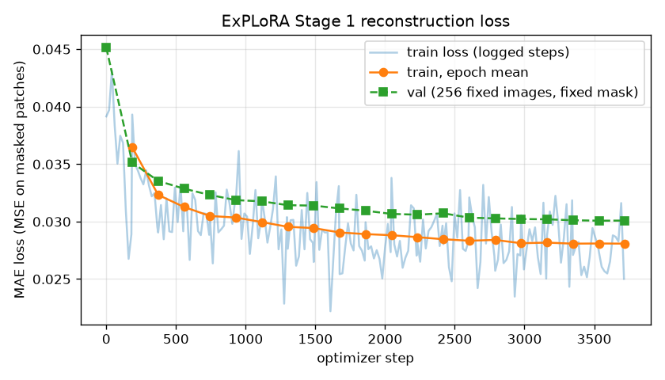
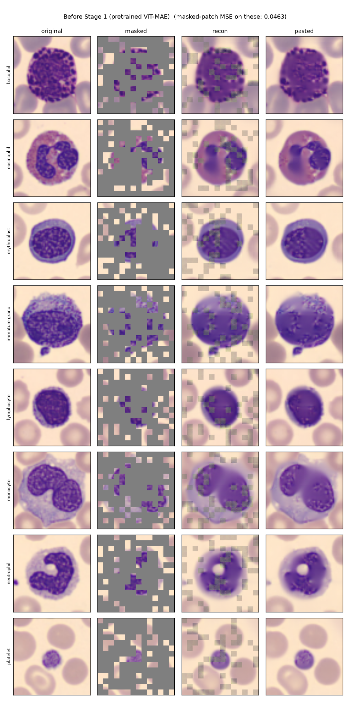
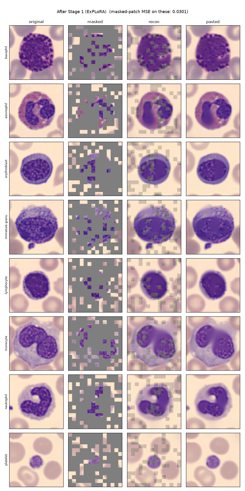

# ExPLoRA on BloodMNIST

Parameter-efficient **extended pretraining** (ExPLoRA, Khanna et al., ICML 2025) of an ImageNet-pretrained
`facebook/vit-mae-base` on unlabeled BloodMNIST images, evaluated by linear probing before and after.

- **Experiment tracking:** wandb project `explora-bloodmnist` → _TODO: paste the project/report link_
- **Package manager:** [uv](https://docs.astral.sh/uv/) (`pyproject.toml` + `uv.lock`)
- **Assignment:** [problem-statement.md](problem-statement.md) · **How this was built:** [GUIDE.md](GUIDE.md)

## Setup
```bash
uv sync
uv run wandb login
uv run pytest -q          # 47 unit tests (LoRA, ExPLoRA config, training loop, probe, merge)
```

## Run
```bash
uv run python scripts/run_probe.py --tag baseline                       # Task 1: baseline linear probe
uv run python scripts/run_stage1.py --time-only                         # time one epoch
uv run python scripts/run_stage1.py --epochs 20                         # Task 2: ExPLoRA Stage 1
uv run python scripts/run_probe.py --tag explora \
    --checkpoint checkpoints/stage1/final.pt                            # Task 3: merge LoRA + probe
```
Colab/Kaggle: `notebooks/stage1_colab_kaggle.ipynb` (checkpoints to Google Drive every epoch, resumable).

## Method
| | |
|---|---|
| Data | BloodMNIST, 64×64, 8 classes; train 11,959 / test 3,421. Upsampled to 224×224, ImageNet normalisation |
| Backbone | `facebook/vit-mae-base` (ViT-B/16 encoder, 8-block decoder), `ViTMAEForPreTraining` |
| Stage 1 trainable set | encoder block 12 fully unfrozen · LoRA r=8 on Q,V of encoder blocks 1–11 and all decoder blocks · all LayerNorms → _TODO_ params (_TODO_ %) |
| Stage 1 objective | MAE loss, mask ratio 0.75, unlabeled train images, fp16 AMP |
| Merge | W = W₀ + (α/r)·BA for every LoRA layer (`src/explora/lora.py: merge_lora`) |
| Linear probe | frozen encoder, no masking → CLS token / mean patch token → StandardScaler + multinomial LogisticRegression (C=1), fit on train, evaluated on test |

## Code map
| Viva question | Where |
|---|---|
| (a) Linear-probe classification | `src/explora/probe.py`: `extract_features`, `fit_linear_probe` |
| (b) LoRA | `src/explora/lora.py`: `LoRALinear`, `inject_lora` |
| (c) ExPLoRA | `src/explora/explora.py`: `configure_explora` · `src/explora/train.py`: `train_one_epoch` · `lora.py`: `merge_lora` |
| (d) Results | below + wandb |

## Results
_TODO (Day 3)_

| Encoder | Pooling | Test acc | Test macro-F1 |
|---|---|---|---|
| Baseline (ImageNet MAE) | CLS | | |
| Baseline (ImageNet MAE) | mean | | |
| ExPLoRA (merged) | CLS | | |
| ExPLoRA (merged) | mean | | |

Stage 1: _TODO_ epochs × _TODO_ s/epoch on _TODO GPU_; reconstruction loss _TODO_ → _TODO_.



| Before Stage 1 | After Stage 1 |
|---|---|
|  |  |

## Discussion
_TODO: your answers to GUIDE.md P7._
