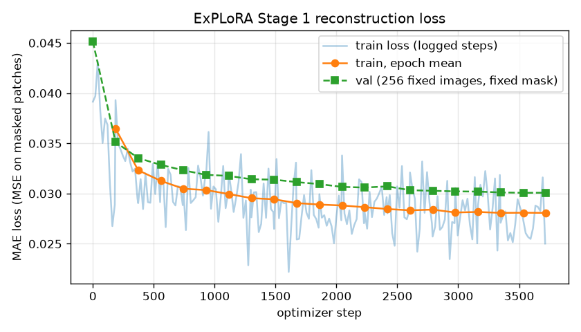
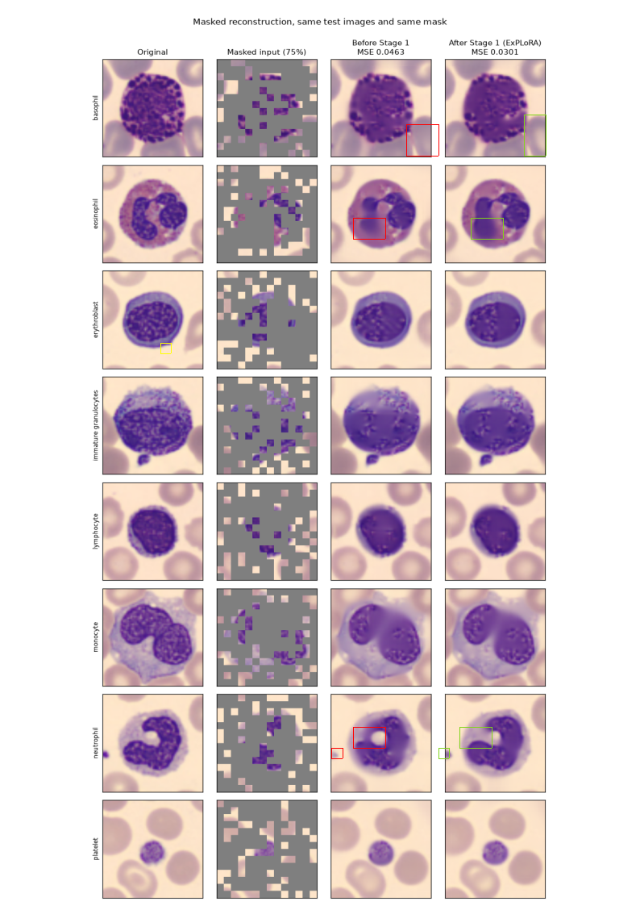

# ExPLoRA on BloodMNIST

Nov 24, 2026   Panshul, Varun

Setup

- **Code:** [GitHub repository](https://github.com/Panshul-Jindal/PlayingWithParameterEfficientFineTuning). The environment is pinned with uv (`pyproject.toml` + `uv.lock`): Python 3.12, PyTorch 2.15, transformers 5.24.
- **Tracking:** [W&B project](https://forge.coreweave.com/wandb/models-indian-institute-of-technology-hyderabad/explora-bloodmnist). Runs: [baseline probe](https://forge.coreweave.com/wandb/models-indian-institute-of-technology-hyderabad/explora-bloodmnist/runs/d2299qta), [Stage 1](https://forge.coreweave.com/wandb/models-indian-institute-of-technology-hyderabad/explora-bloodmnist/runs/hfo1m5on), [ExPLoRA probe](https://forge.coreweave.com/wandb/models-indian-institute-of-technology-hyderabad/explora-bloodmnist/runs/sy2joatw). Every run logs its git commit.
- **GPU:** NVIDIA RTX 3060 Laptop (6 GB), fp16 mixed precision. Stage 1 peaks at 3.45 GB and takes about 77 s per epoch (26 min for 20 epochs).

**Data**: *BloodMNIST   From the MedMNIST v2 paper (Yang et al., Scientific Data, 2023)*

- The BloodMNIST is based on a dataset of individual normal cells, captured from healthy individuals  i.e without infection, hematologic or oncologic disease and free of any pharmacologic treatment at the moment of blood collection.

* It contains a total of 17,092 images and is organized into 8 classes with split ratio of 7:1:2 (11,959 / 1,712 / 3,421).
* &#32;Resolution pipeline: 360×363 → center-crop to 200×200 → resize to 64×64 (the larger MedMNIST+ version we download; 28 is the classic size)&#32;
* We use RGB images as input thus (3,64,64) is an image size.&#32;
* It's center cropped thus cell sits in the middle.&#32;

**Data Augmentation**

- Common Augmentation
  - We normalize using image net mean and image net std  (Why?)

* Testing Augmentation
  - We employ fixed upsampling to 224\*224 using bilinear interpolation.
* Training Augmentation
  - Random Resized Crop to 224\*224 keeping scale as 0.5 to 1 i.e keeping atleast 50% coverage of the original image to make sure atleat half cell comes..
  - Random Horizontal and Vertical Flips&#32;

Why upsample?&#32;

- we upsample to 224 for the ViT as it creates patches using conv2d(16,16,stride=16), thus weights for patching itself are learned at input size of 224\*224 (it was originally trained on that) .

> If we had used smaller, there would be just 16 patches created which might have been too less.&#32;

## Metrics&#32;

We use accuracy as the metric which is meaningful since the dataset isn't too imbalanced.

We also report Macro F1 Score giving equal weightage to each and every class.&#32;

## Model&#32;

We use  f*acebook/vit-mae-base as **the pretrained backbone. *

The model architecture can be found in appendix.&#32;

## Task 1: Baseline linear probe

*In @probe.py*

Feature Extraction

- Turn off masking
- Sending the whole image to the vit&#32;
- Using cls embeddings and mean of all other patches as the two embeddings representation of that image&#32;

Linear Probing

- Data-> Each image, class\_label pair turns to (image\_features, class\_label)
- Mean-Variance Standardization of train dataset and using the same for validation and test.
- Fitting a logistic regrestion with max iterations of 2000, accross various parameter values of C is the *inverse L2 regularisation strength of the logistic regression * and choose the one with best validation accuracy

| C | CLS val acc | Mean val acc |
| --- | --- | --- |
| 0.001 | 96.73% | 96.61% |
| 0.003 | 97.43% | 97.14% |
| 0.01 | 97.61% | 97.61% |
| 0.03 | **97.84% (chosen)** | **97.78% (chosen)** |
| 0.1 | 97.72% | 97.72% |
| 0.3 | 97.61% | 97.78% |
| 1 | 97.31% | 97.61% |

From results thus C=0.03 was chosen as the final value.

| Pooling | Test errors at C = 0.03 (val-chosen) |
| --- | --- |
| CLS | 77 |
| Mean | 77 |

## Task 2: ExPLoRA Stage 1

What trains? @explore.py

- Last encoder block of vit is unfrozen
- LoRA adaptors(A,B) to  Query, Value matrices of all the frozen encoder blocks and decoder blocks was unfrozen
- Layer norms of all the layers for encoder as well as decoder for unfrozen

The loss curve&#32;

We see train and val loss saturates after 20 epochs.. and thus 20 epochs were more than enough for the finetuning, so it's kinda convergence was reached.

We definitely see that reconstruction loss decreases: on 256 fixed validation images with a fixed mask, the masked-patch MSE fell from 0.0451 to 0.0301, a 33% drop.&#32;&#32;&#32;

*"Red: errors before Stage 1. Green: the same region after."*

"Yellow" where both of them didn't do well"

We see there are improvements in reconstruction quality.!

Trainable: 7,542,016 / 112,309,248 

Loss and masking ratio was kept same as pretraining configuration&#32;

We trained for a total of 20 epochs.

The one epoch took 81 s, so 20 epochs (about 27 minutes) fit the budget.

## Task 3: Merge and re-probe

Merging the delta weights obtained by the LoRA to the model.&#32;

W = W₀ + (α/r)·BA

And then applying the same setup of linear probing with same number of single validation applied in the previous step.&#32;

## Results

| Encoder | Pooling | C (picked on val) | Test acc | Test macro-F1 | Test errors (of 3,421) |
| --- | --- | --- | --- | --- | --- |
| Baseline | CLS | 0.03 | 97.75% | 0.9779 | 77 |
| Baseline | Mean | 0.03 | 97.75% | 0.9777 | 77 |
| ExPLoRA | CLS | 0.03 | 98.25% | 0.9834 | 60 |
| ExPLoRA | Mean | 0.03 | 98.33% | 0.9834 | 57 |

- **Both poolings independently chose `C = 0.03` again,** so the protocol was identical for both encoders.
- **22–26% fewer errors.** CLS goes from 77 to 60 errors and mean from 77 to 57, about +0.5 points of accuracy.&#32;

Twenty epochs of self-supervised reconstruction on unlabeled blood-cell images, training 6.7% of the weights, made the frozen features clearly more separable.

Quantitatively, the increase in accuracy is just 0.5 percent, is it signficant?

That's something which should come from statistics, but I don't know how to quantify.

**CLS pooling**:  Net +17 images

| 3,421 test images | ExPLoRA right | ExPLoRA wrong |
| --- | --- | --- |
| Baseline right | 3,325 | 19 (broken) |
| Baseline wrong | 36 (fixed) | 41 (both wrong) |

**Mean pooling**: Net +20 images

| 3,421 test images | ExPLoRA right | ExPLoRA wrong |
| --- | --- | --- |
| Baseline right | 3,320 | 24 (broken) |
| Baseline wrong | 44 (fixed) | 33 (both wrong) |

## Appendix&#32;

### Class-Wise Distribution&#32;

| Class | Train | Train % | Val | Val % |
| --- | --- | --- | --- | --- |
| neutrophil | 2,330 | 19.5% | 333 | 19.5% |
| eosinophil | 2,181 | 18.2% | 312 | 18.2% |
| immature granulocytes | 2,026 | 16.9% | 290 | 16.9% |
| platelet | 1,643 | 13.7% | 235 | 13.7% |
| erythroblast | 1,085 | 9.1% | 155 | 9.1% |
| monocyte | 993 | 8.3% | 143 | 8.4% |
| basophil | 852 | 7.1% | 122 | 7.1% |
| lymphocyte | 849 | 7.1% | 122 | 7.1% |
| **Total** | **11,959** |  | **1,712** |  |

## Model Architecture

ViTMAEForPreTraining(

&#32;&#32;(vit): ViTMAEModel(

&#32;&#32;&#32;&#32;(embeddings): ViTMAEEmbeddings(

&#32;&#32;&#32;&#32;&#32;&#32;(patch\_embeddings): ViTMAEPatchEmbeddings(

&#32;&#32;&#32;&#32;&#32;&#32;&#32;&#32;(projection): Conv2d(3, 768, kernel\_size=(16, 16), stride=(16, 16))

&#32;&#32;&#32;&#32;&#32;&#32;)

&#32;&#32;&#32;&#32;)

&#32;&#32;&#32;&#32;(layers): ModuleList(

&#32;&#32;&#32;&#32;&#32;&#32;(0-11): 12 x ViTMAELayer(

&#32;&#32;&#32;&#32;&#32;&#32;&#32;&#32;(attention): ViTMAEAttention(

&#32;&#32;&#32;&#32;&#32;&#32;&#32;&#32;&#32;&#32;(q\_proj): Linear(in\_features=768, out\_features=768, bias=True)

&#32;&#32;&#32;&#32;&#32;&#32;&#32;&#32;&#32;&#32;(k\_proj): Linear(in\_features=768, out\_features=768, bias=True)

&#32;&#32;&#32;&#32;&#32;&#32;&#32;&#32;&#32;&#32;(v\_proj): Linear(in\_features=768, out\_features=768, bias=True)

&#32;&#32;&#32;&#32;&#32;&#32;&#32;&#32;&#32;&#32;(o\_proj): Linear(in\_features=768, out\_features=768, bias=True)

&#32;&#32;&#32;&#32;&#32;&#32;&#32;&#32;)

&#32;&#32;&#32;&#32;&#32;&#32;&#32;&#32;(layernorm\_before): LayerNorm((768,), eps=1e-12, elementwise\_affine=True, bias=True)

&#32;&#32;&#32;&#32;&#32;&#32;&#32;&#32;(layernorm\_after): LayerNorm((768,), eps=1e-12, elementwise\_affine=True, bias=True)

&#32;&#32;&#32;&#32;&#32;&#32;&#32;&#32;(mlp): ViTMAEMLP(

&#32;&#32;&#32;&#32;&#32;&#32;&#32;&#32;&#32;&#32;(activation\_fn): GELUActivation()

&#32;&#32;&#32;&#32;&#32;&#32;&#32;&#32;&#32;&#32;(fc1): Linear(in\_features=768, out\_features=3072, bias=True)

&#32;&#32;&#32;&#32;&#32;&#32;&#32;&#32;&#32;&#32;(fc2): Linear(in\_features=3072, out\_features=768, bias=True)

&#32;&#32;&#32;&#32;&#32;&#32;&#32;&#32;)

&#32;&#32;&#32;&#32;&#32;&#32;&#32;&#32;(dropout): Dropout(p=0.0, inplace=False)

&#32;&#32;&#32;&#32;&#32;&#32;)

&#32;&#32;&#32;&#32;)

&#32;&#32;&#32;&#32;(layernorm): LayerNorm((768,), eps=1e-12, elementwise\_affine=True, bias=True)

&#32;&#32;)

&#32;&#32;(decoder): ViTMAEDecoder(

&#32;&#32;&#32;&#32;(decoder\_embed): Linear(in\_features=768, out\_features=512, bias=True)

&#32;&#32;&#32;&#32;(decoder\_layers): ModuleList(

&#32;&#32;&#32;&#32;&#32;&#32;(0-7): 8 x ViTMAELayer(

&#32;&#32;&#32;&#32;&#32;&#32;&#32;&#32;(attention): ViTMAEAttention(

&#32;&#32;&#32;&#32;&#32;&#32;&#32;&#32;&#32;&#32;(q\_proj): Linear(in\_features=512, out\_features=512, bias=True)

&#32;&#32;&#32;&#32;&#32;&#32;&#32;&#32;&#32;&#32;(k\_proj): Linear(in\_features=512, out\_features=512, bias=True)

&#32;&#32;&#32;&#32;&#32;&#32;&#32;&#32;&#32;&#32;(v\_proj): Linear(in\_features=512, out\_features=512, bias=True)

&#32;&#32;&#32;&#32;&#32;&#32;&#32;&#32;&#32;&#32;(o\_proj): Linear(in\_features=512, out\_features=512, bias=True)

&#32;&#32;&#32;&#32;&#32;&#32;&#32;&#32;)

&#32;&#32;&#32;&#32;&#32;&#32;&#32;&#32;(layernorm\_before): LayerNorm((512,), eps=1e-12, elementwise\_affine=True, bias=True)

&#32;&#32;&#32;&#32;&#32;&#32;&#32;&#32;(layernorm\_after): LayerNorm((512,), eps=1e-12, elementwise\_affine=True, bias=True)

&#32;&#32;&#32;&#32;&#32;&#32;&#32;&#32;(mlp): ViTMAEMLP(

&#32;&#32;&#32;&#32;&#32;&#32;&#32;&#32;&#32;&#32;(activation\_fn): GELUActivation()

&#32;&#32;&#32;&#32;&#32;&#32;&#32;&#32;&#32;&#32;(fc1): Linear(in\_features=512, out\_features=2048, bias=True)

&#32;&#32;&#32;&#32;&#32;&#32;&#32;&#32;&#32;&#32;(fc2): Linear(in\_features=2048, out\_features=512, bias=True)

&#32;&#32;&#32;&#32;&#32;&#32;&#32;&#32;)

&#32;&#32;&#32;&#32;&#32;&#32;&#32;&#32;(dropout): Dropout(p=0.0, inplace=False)

&#32;&#32;&#32;&#32;&#32;&#32;)

&#32;&#32;&#32;&#32;)

&#32;&#32;&#32;&#32;(decoder\_norm): LayerNorm((512,), eps=1e-12, elementwise\_affine=True, bias=True)

&#32;&#32;&#32;&#32;(decoder\_pred): Linear(in\_features=512, out\_features=768, bias=True)

&#32;&#32;)

)

### Runs

All four ran from committed code with no local changes, and each W&B run records its commit.

| Run | What it did | Commit | W&B | Result |
| --- | --- | --- | --- | --- |
| Baseline probe (Task 1) | Linear probe on the pretrained encoder, C picked on val | `b4dea93` | [d2299qta](https://forge.coreweave.com/wandb/models-indian-institute-of-technology-hyderabad/explora-bloodmnist/runs/d2299qta) | Test acc 97.75% (CLS and mean), C = 0.03 |
| Timing (Task 2) | One Stage 1 epoch, to size the run | `a9578eb` | [gv38nmgn](https://forge.coreweave.com/wandb/models-indian-institute-of-technology-hyderabad/explora-bloodmnist/runs/gv38nmgn) | 81 s per epoch (186 steps of 64) |
| Stage 1 (Task 2) | ExPLoRA, 20 epochs | `3dffdd0` | [hfo1m5on](https://forge.coreweave.com/wandb/models-indian-institute-of-technology-hyderabad/explora-bloodmnist/runs/hfo1m5on) | Val MAE loss 0.0451 → 0.0301 |
| ExPLoRA probe (Task 3) | Merge LoRA, same probe protocol | `7b15246` | [sy2joatw](https://forge.coreweave.com/wandb/models-indian-institute-of-technology-hyderabad/explora-bloodmnist/runs/sy2joatw) | Test acc 98.25% (CLS), 98.33% (mean), C = 0.03 |
